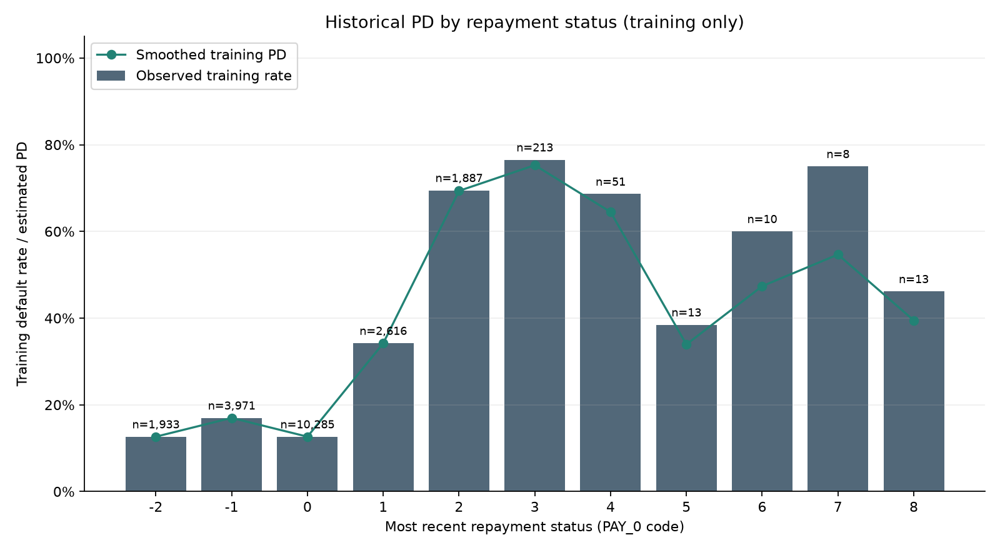
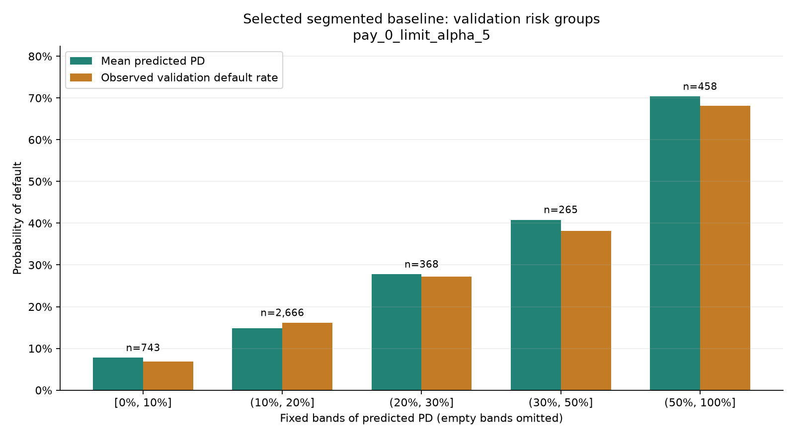
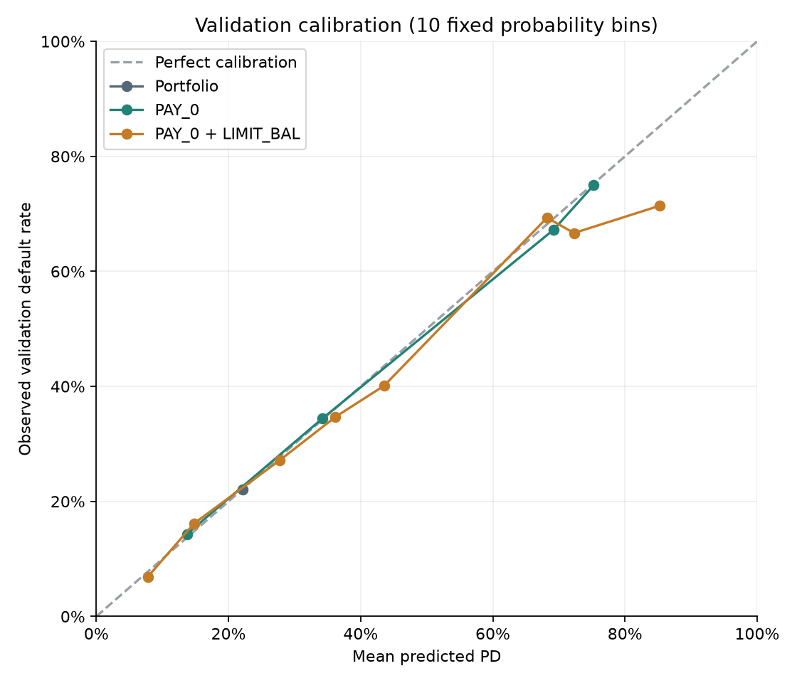
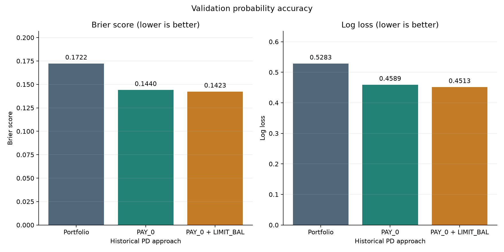

# Step 4: Historical probability of default

## Objective

Build reproducible historical PD benchmarks for the later logistic-regression comparison.
This step fits a portfolio rate, PAY_0 rates, and PAY_0 crossed with credit-limit bands.
Step 5, LGD, and ECL are outside this implementation.

## Existing dataset and split audit

The existing `main.py` implements the UCI ID 350 download, descriptive renaming,
EDUCATION 5/6-to-0 cleaning, and stratified 70/15/15 split with random_state=42.
All three processed CSVs already existed. They were reused without fetching data,
rerunning Step 3, deduplicating, or rewriting any input. No notebook was present.
Training and validation each have 23 predictors plus `default_next_month`,
zero missing values, binary targets, and cleaned EDUCATION codes 0 through 4.

| Split | Customers | Defaults | Observed default rate |
| --- | ---: | ---: | ---: |
| Training | 21,000 | 4,645 | 22.119048% |
| Validation | 4,500 | 995 | 22.111111% |
| Test (descriptive only) | 4,500 | 996 | 22.133333% |

There are 18 duplicate full rows within training and
2 within validation. 9
validation rows have an exact match across all predictor columns in training.
The CSVs lack customer IDs, so independent customers cannot be verified. These
pre-existing repeats can make validation optimistic; preserve the splits for the
Step 5 comparison and investigate them before any later resplitting.

## Historical PD calculation

The portfolio estimate is 4,645 / 21,000
= **0.22119048 (22.1190%)**.
Every validation customer receives this value. The requested constant assignment
for every test row is saved in `tables/step_04_test_portfolio_predictions.csv`;
it uses no test predictors or individual outcomes. A constant score cannot
distinguish low-risk and high-risk borrowers: every pair is tied and validation
ROC-AUC is 0.500000 when both target classes are present.

## Segmentation and sparse groups

Only PAY_0 and LIMIT_BAL enter the segmented models. Demographics and additional
financial ratios are excluded to keep these benchmarks simple and interpretable.
PAY_0 uses the recorded integer categories, without imposing undocumented meanings
on the nonpositive codes. Both segmented models are fitted using training outcomes only.

The joint model requests five training quantile bands. Its internal cutoffs are
**50,000, 100,000, 180,000, 270,000 NTD**, producing 5 actual bands.
Intervals are right-closed; e.g. a value equal to the first cutoff belongs to the
first band. The outer bands extend to negative/positive infinity mathematically;
only positive finite limits are accepted into them. Positive values outside the
training range enter the outer bands. Repeated quantile edges are removed; constant
training limits give one band. Validation/test values never set the boundaries.

For alpha pseudo-observations, training estimates are:

```text
portfolio_pd = training_defaults / training_customers
status_pd = (status_defaults + alpha * portfolio_pd) / (status_customers + alpha)
joint_pd = (joint_defaults + alpha * status_pd) / (joint_customers + alpha)
```

All observed groups are smoothed; small groups receive more shrinkage. This is a
hierarchical heuristic, not an independently specified Bayesian posterior, since
the parent rates also contain the subgroup observations. Unseen joint combinations
and missing/nonpositive/nonfinite credit limits fall back to the smoothed status PD.
Unseen or missing PAY_0 falls back to portfolio PD. Missing required columns,
nonnumeric inputs, and noninteger repayment codes raise a clear error.

Training repayment-status estimates for the selected PAY_0-only configuration:

| PAY_0 | customers | defaults | raw_pd | parent_pd | estimated_pd |
| --- | --- | --- | --- | --- | --- |
| -2.000000 | 1933 | 244.000000 | 0.126229 | 0.221190 | 0.126474 |
| -1.000000 | 3971 | 674.000000 | 0.169731 | 0.221190 | 0.169795 |
| 0.000000 | 10285 | 1300.000000 | 0.126398 | 0.221190 | 0.126444 |
| 1.000000 | 2616 | 895.000000 | 0.342125 | 0.221190 | 0.341895 |
| 2.000000 | 1887 | 1311.000000 | 0.694754 | 0.221190 | 0.693502 |
| 3.000000 | 213 | 163.000000 | 0.765258 | 0.221190 | 0.752780 |
| 4.000000 | 51 | 35.000000 | 0.686275 | 0.221190 | 0.644749 |
| 5.000000 | 13 | 5.000000 | 0.384615 | 0.221190 | 0.339220 |
| 6.000000 | 10 | 6.000000 | 0.600000 | 0.221190 | 0.473730 |
| 7.000000 | 8 | 6.000000 | 0.750000 | 0.221190 | 0.546612 |
| 8.000000 | 13 | 6.000000 | 0.461538 | 0.221190 | 0.394775 |

## Validation selection and results

Each segmentation family tries alpha in [5, 20, 50, 100, 200] with five requested
credit-limit bands fixed in advance. The selection rule is lowest validation log
loss, then lowest Brier score; exact remaining ties prefer fewer segmentation
features and then model ID. No validation target enters training rates or cutoffs.
Validation labels are used for scoring and configuration selection only.
All 11 candidate scores are in `tables/step_04_tuning_results.csv`.
The table below retains the best alpha within each segmentation family; smoothing
is N/A for the portfolio estimator. Brier, log loss, and ECE are lower-is-better;
ROC-AUC is higher-is-better. Calibration bias is predicted minus observed PD.

| approach | smoothing | brier_score | log_loss | roc_auc | mean_predicted_pd | calibration_bias | ece_10_bins |
| --- | --- | --- | --- | --- | --- | --- | --- |
| Portfolio | N/A | 0.172221 | 0.528311 | 0.500000 | 0.221190 | 0.000079 | 0.000079 |
| PAY_0 | 5.000000 | 0.144016 | 0.458906 | 0.701999 | 0.217709 | -0.003402 | 0.006990 |
| PAY_0 + LIMIT_BAL | 5.000000 | 0.142316 | 0.451350 | 0.741653 | 0.218801 | -0.002310 | 0.015224 |

The selected segmented configuration is **`pay_0_limit_alpha_5`**. The lowest observed
validation log loss across all baselines belongs to **`pay_0_limit_alpha_5`**
(0.451350). The selected segmented model changes Brier score by
17.36% and log loss by 14.57% relative to the portfolio
(positive percentages denote reductions). Its ROC-AUC is 0.741653,
versus 0.500000 for the portfolio. These are point estimates on the
same validation set used for selection, not evidence of statistical significance
or out-of-sample superiority. Probability accuracy, ranking, and calibration
must be considered separately.

Calibration uses 10 fixed equal-width probability bins. ECE is the customer-weighted
absolute predicted-versus-observed gap across nonempty bins, so its value depends
on the chosen bins. Signed aggregate calibration bias can hide offsetting errors.
The calibration CSV includes counts and signed gaps; no post-hoc calibrator is fitted.

Selected segmented model risk analysis (fixed PD bands; empty bands omitted):

| pd_band | customers | defaults | mean_predicted_pd | observed_default_rate | calibration_gap |
| --- | --- | --- | --- | --- | --- |
| [0%, 10%] | 743 | 51 | 0.077709 | 0.068641 | 0.009069 |
| (10%, 20%] | 2666 | 431 | 0.147871 | 0.161665 | -0.013795 |
| (20%, 30%] | 368 | 100 | 0.277728 | 0.271739 | 0.005989 |
| (30%, 50%] | 265 | 101 | 0.408249 | 0.381132 | 0.027117 |
| (50%, 100%] | 458 | 312 | 0.703614 | 0.681223 | 0.022391 |

The selected model's ECE is 0.015224, compared with
0.006990 for PAY_0 alone and 0.000079 for
the constant portfolio. Lower loss and better ranking therefore do not imply
better calibration by this binned measure. The portfolio's nearly exact aggregate
calibration is expected in these stratified splits and does not measure ranking.
The risk-band table shows local calibration with customer counts; thin bands have
noisier observed rates. Tables for actual PAY_0 and joint segments, including
fallback sources, are also saved separately.

## Figures









## Limitations and interpretation

The portfolio baseline can be well calibrated in aggregate while having no ranking
ability. The segmented baselines can distinguish financial risk groups, but assume
future customers resemble the training cohort. Rare groups and coarse credit-limit
bands limit precision. Smoothed probabilities depend on alpha and parent-rate quality.
No confidence intervals, significance tests, demographic fairness analysis, or
temporal validation are included. This snapshot predicts default next month; it
does not establish annual/lifetime PD, causal effects, LGD, or ECL.

The random split does not test changes in default behavior over time. Validation
was used repeatedly for a small predefined parameter grid and may be optimistic.
Identical feature records across splits are another limitation. Test outcomes did
not influence fitting or selection: only the explicitly requested overall test
count/default rate was read, after choices were frozen. There are no test loss,
AUC, calibration results, or segmented test predictions in Step 4.

## Reproduction and checks

From the project root, run:

```powershell
.\.venv\Scripts\python.exe -m unittest discover -s tests -v
.\.venv\Scripts\python.exe run_step_04.py
```

The runner is independent of the current working directory and accepts `--data-dir`
and `--report-dir`. It uses the installed pandas, NumPy, scikit-learn, and matplotlib
environment, requires no new dependency installation, and performs no random sampling.
Every prediction array is checked for length, finite values, and PD in [0, 1].
Saved JSON models are reloaded and checked for exact prediction agreement. Automated
tests also cover sparse/unseen groups, training-only cutoffs, missing inputs,
one-class evaluation, and ignored target/demographic columns at prediction time.
The runner verifies SHA-256 hashes of all three processed CSVs are unchanged.
`step_04_run_manifest.json` records these hashes, dependency versions, selection,
split counts, and fallback counts. Original `main.py` is preserved.

## Recommendations for Step 5

Keep these same processed splits and their hashes. Fit logistic regression using
training data only, including any scaling/encoding, and choose its hyperparameters
on validation with the same metrics. Freeze all choices before the single final
test comparison. Compare the portfolio, both frozen segmented configurations, and
logistic regression on exactly the same test rows. Retain calibration and risk-band
analysis alongside discrimination; report uncertainty before claiming superiority.
Investigate duplicate/customer identity and temporal representativeness before
using the estimates for decisions.

Load a frozen historical model for new customer rows without refitting:

```python
from historical_pd import load_model

model = load_model("reports/models/pay_0_limit_alpha_5.json")
pd_values = model.predict(new_customers)  # DataFrame with PAY_0 and, if needed, LIMIT_BAL
```

Source files: `F:\Old Assignments\Real World\Credit Risk Project\data\processed\train.csv`, `F:\Old Assignments\Real World\Credit Risk Project\data\processed\validation.csv`, `F:\Old Assignments\Real World\Credit Risk Project\data\processed\test.csv`.
