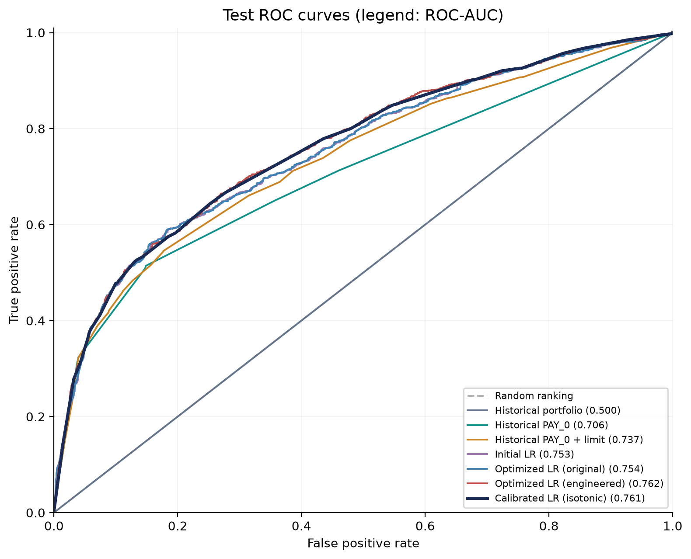
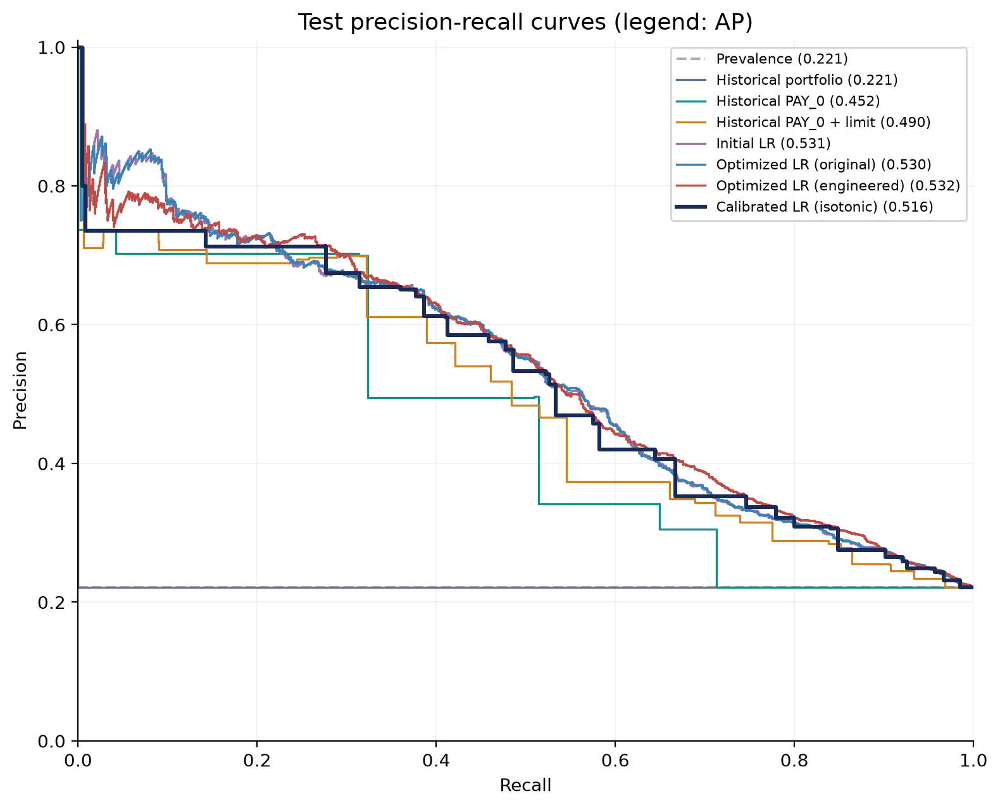
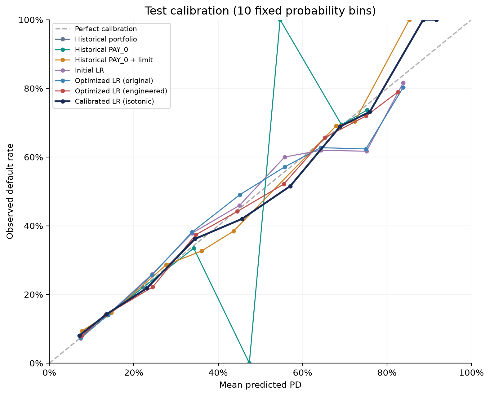
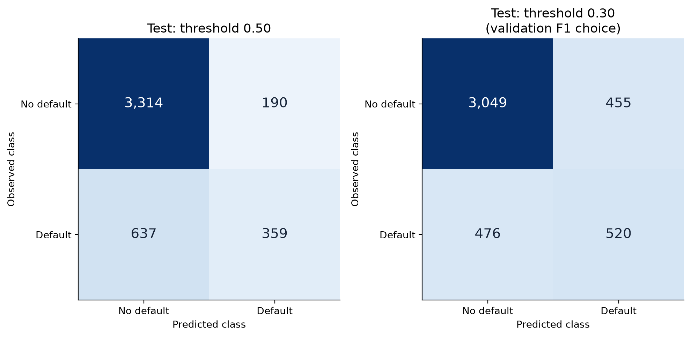
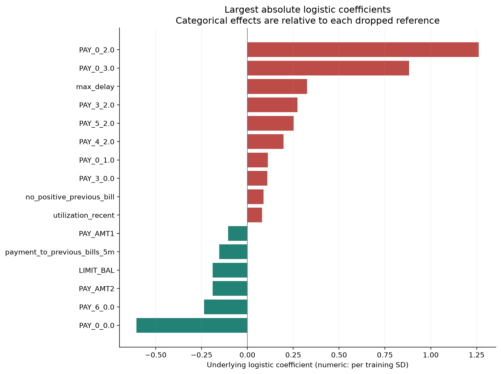
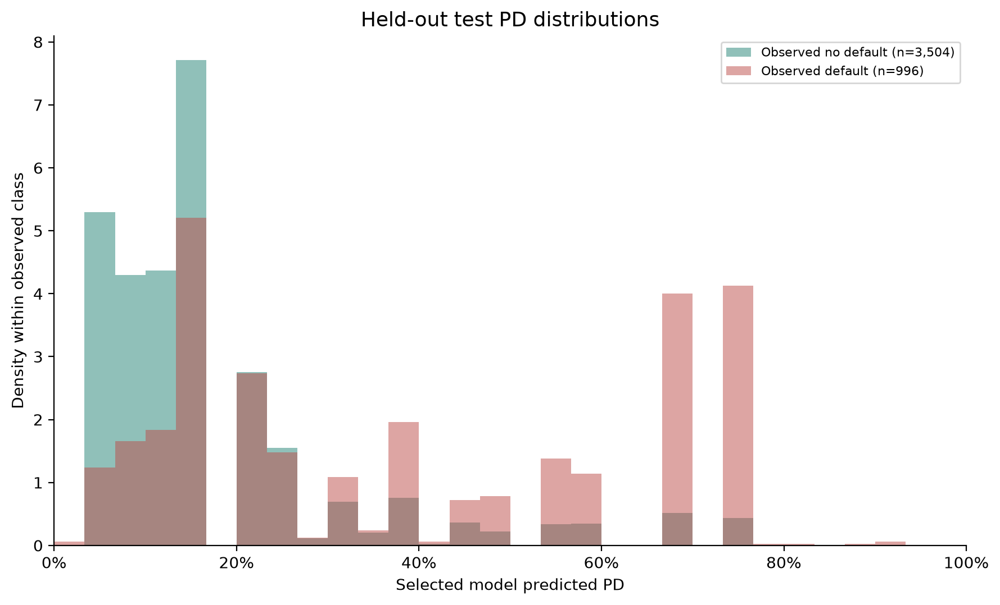
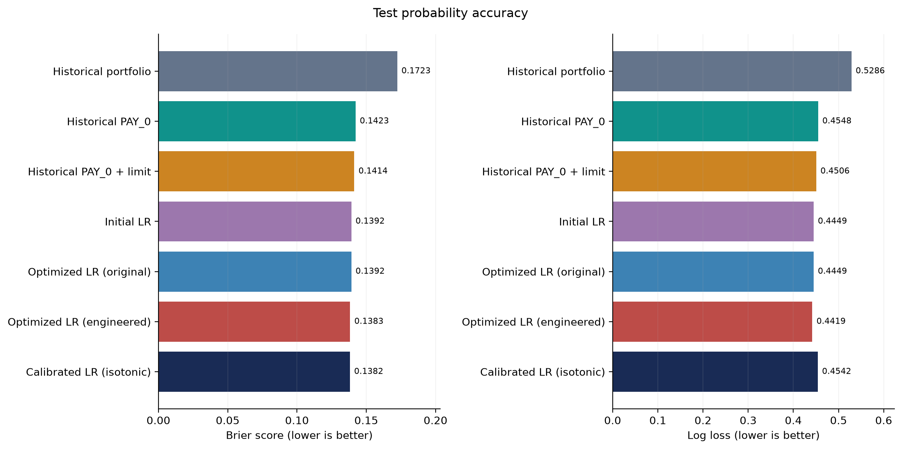

# Step 5: Logistic regression probability of default

## Executive summary and objective

The selected PD model is **Calibrated LR (isotonic)**, with base configuration
`optimized_engineered` and calibration **isotonic**.
On the untouched final comparison rows it has ROC-AUC **0.760735**,
Brier score **0.138193**, log loss **0.454164**,
and average precision **0.515534**.
The goal is individualized next-month default probabilities from financial and
repayment history, compared with the three frozen Step 4 estimators. Conclusions
below use measured differences rather than assuming logistic regression is better.
Relative to Historical PAY_0 + limit, the selected model has higher ROC-AUC, lower Brier score, and higher log loss. The evidence does not establish superiority on every probability-quality measure.

## Data, preprocessing, and feature design

Existing stratified splits were reused: 21,000 training, 4,500 validation, and 4,500
test rows, with default rates 22.1190%, 22.1111%, and 22.1333%. No rows were dropped,
deduplicated, or reassigned. File SHA-256 hashes match Step 4. The original code,
processed CSVs, and all Step 4 reports/models are unchanged. No new data download
was needed. Customer IDs are absent; row keys combine the input CSV hash with its
zero-based row number for an auditable common evaluation order.

The original-feature model uses 19 predictors: LIMIT_BAL, six BILL_AMT variables,
six PAY_AMT variables, and six repayment-status codes. SEX, AGE, MARRIAGE, and
EDUCATION are excluded. This narrows the comparison to financial behavior; it does
not establish demographic fairness or eliminate demographic proxies.

Each pipeline selects financial columns, creates any deterministic engineered
features, standardizes numeric variables, and one-hot encodes repayment statuses.
Categories seen fewer than 20 times in each fitting subset are pooled. The first
category is dropped (the all-training reference is -2 for each status). Unknown
codes use the learned infrequent category when available; otherwise sklearn uses
the all-zero reference encoding and may warn. Missing/nonfinite required values,
nonpositive limits, negative payments, and noninteger codes are rejected explicitly.
No scaler, category list, or rare-category grouping is fitted outside training or
the corresponding training-CV fold.

Eight engineered features add recent and mean signed utilization, recent and
five-month payment coverage, an indicator of no positive previous bill, the count
of positive delay codes, maximum positive delay, and recent balance change divided
by credit limit. Recent payment coverage uses September payment / positive August
bill; five-month coverage pairs September-May payments with August-April bills.
These are approximate coverage proxies, not contractual payment rates. Coverage
is 0 if its denominator is nonpositive, capped at 5; the separate indicator helps
distinguish the recent no-positive-bill case. Utilization is capped at [-5, 10],
and normalized balance change at [-10, 10], using fixed rules. All inputs predate
the next-month target. Average balance and raw balance change are linear combinations
of original bills; their normalized versions provide more useful nonlinear inputs.
The month mapping follows the [UCI dataset description](https://archive.ics.uci.edu/dataset/350/default+of+credit+card+clients).

Training bill audit:

| feature | negative_bills | zero_bills | minimum | maximum |
| --- | --- | --- | --- | --- |
| BILL_AMT1 | 412 | 1399 | -165580.000000 | 964511.000000 |
| BILL_AMT2 | 457 | 1734 | -69777.000000 | 983931.000000 |
| BILL_AMT3 | 439 | 2004 | -61506.000000 | 855086.000000 |
| BILL_AMT4 | 467 | 2224 | -81334.000000 | 891586.000000 |
| BILL_AMT5 | 464 | 2448 | -81334.000000 | 927171.000000 |
| BILL_AMT6 | 492 | 2808 | -209051.000000 | 961664.000000 |

Negative bills are retained in original features and signed utilization. Credit
balances can arise when credits exceed what is owed, as explained by the
[CFPB](https://www.consumerfinance.gov/ask-cfpb/what-is-a-credit-balance-on-my-credit-card-bill-en-42/).
This is a plausible interpretation, not verified account-level provenance for
these UCI records. No negative bill is automatically labeled corrupt or deleted.

## Logistic methodology and optimization

PD is `sigmoid(intercept + sum(coefficient * transformed_feature))`, obtained
through `predict_proba()[:, 1]`. Initial logistic regression uses L2, C=1,
lbfgs, max_iter=2000, random_state=42. Optimization compares L1 and L2 with
liblinear, C in [0.001, 0.01, 0.1, 1.0, 10.0, 100.0], five stratified training folds shuffled with
seed 42, and refits each family's best mean CV log-loss configuration on all
training rows. Brier, ROC-AUC, and AP are also recorded. The liblinear intercept
uses intercept_scaling=10 and is regularized through its synthetic feature.
Training-CV pipelines refit preprocessing inside every fold. Original and engineered
families use the identical fold assignment, saved in the CV membership table.

| feature_family | C | regularization | mean_cv_log_loss | sd_cv_log_loss | mean_cv_brier |
| --- | --- | --- | --- | --- | --- |
| original | 1.000000 | L1 | 0.436141 | 0.005656 | 0.135983 |
| engineered | 0.100000 | L1 | 0.432835 | 0.005677 | 0.135117 |

The installed scikit-learn uses `l1_ratio=0` for L2 and `l1_ratio=1` for L1;
the deprecated penalty argument is avoided, following the
[official LogisticRegression API](https://scikit-learn.org/stable/modules/generated/sklearn.linear_model.LogisticRegression.html).
ConvergenceWarning is treated as an error, with one retry at 8,000 iterations;
other warnings stay visible. The CV run emitted expected unknown-category warnings
when singleton repayment codes were absent from a fold's fitting rows; the encoder
mapped them to its learned infrequent group. No convergence failure occurred.
No class weighting or resampling was applied, since
probability estimation under the observed prevalence is the primary objective.

Training CV chooses regularization within each feature family. Validation log loss,
then Brier, chooses the feature family. Calibration is investigated on that chosen
base model using sigmoid and isotonic, each fitted with five-fold out-of-fold
training predictions and ensemble=False, then evaluated on validation. The full
pipeline is inside [CalibratedClassifierCV](https://scikit-learn.org/stable/modules/generated/sklearn.calibration.CalibratedClassifierCV.html),
so calibration folds also fit their own preprocessing. The resulting base estimator
is fitted on all training rows, without adding validation rows. Calibration is
adopted only if both validation log loss and Brier improve over the uncalibrated
base. Hyperparameter and calibration choices are not selected from test results.

## Validation results and feature engineering

| Model | roc_auc | brier_score | log_loss | average_precision | ece_10_bins |
| --- | --- | --- | --- | --- | --- |
| Historical portfolio | 0.500000 | 0.172221 | 0.528311 | 0.221111 | 0.000079 |
| Historical PAY_0 | 0.701999 | 0.144016 | 0.458906 | 0.441910 | 0.006990 |
| Historical PAY_0 + limit | 0.741653 | 0.142316 | 0.451350 | 0.481117 | 0.015224 |
| Initial LR | 0.765487 | 0.138621 | 0.441308 | 0.521665 | 0.016149 |
| Optimized LR (original) | 0.765498 | 0.138609 | 0.441255 | 0.522090 | 0.016263 |
| Optimized LR (engineered) | 0.770065 | 0.137774 | 0.438462 | 0.531088 | 0.013957 |
| Calibrated LR (sigmoid) | 0.770065 | 0.137790 | 0.438505 | 0.531088 | 0.014659 |
| Calibrated LR (isotonic) | 0.769385 | 0.137601 | 0.437060 | 0.520565 | 0.010918 |

Engineered minus original optimized validation differences: ROC-AUC
+0.004567, Brier
-0.000835, and log loss
-0.002793. Positive AUC and negative error
differences favor engineering. These measurements, rather than an assumption about
feature engineering, drive the recorded choice. The initial model remains a
benchmark rather than a member of the optimized-family selection pool.

Calibration study (all fits use training data; scores below use validation):

| method | model_id | brier_score | log_loss | roc_auc | mean_predicted_pd | observed_default_rate | calibration_bias | ece_10_bins | selected |
| --- | --- | --- | --- | --- | --- | --- | --- | --- | --- |
| none | optimized_engineered | 0.137774 | 0.438462 | 0.770065 | 0.219655 | 0.221111 | -0.001456 | 0.013957 | False |
| sigmoid | calibrated_sigmoid | 0.137790 | 0.438505 | 0.770065 | 0.219561 | 0.221111 | -0.001551 | 0.014659 | False |
| isotonic | calibrated_isotonic | 0.137601 | 0.437060 | 0.769385 | 0.218945 | 0.221111 | -0.002166 | 0.010918 | True |

## Frozen final test comparison

The final configuration, both thresholds, retained comparators, input hashes, and
serialized model hashes were written to `models/step_05_selection.json` **before
loading test rows**. Test models are the three frozen historical estimators,
initial LR, both optimized feature families, and the selected calibrated variant
only if calibration was adopted. Discarded calibrators were not tested. All use
the same 4,500 rows in the same order. Baselines are loaded from Step 4 JSON files,
never refitted. Their validation predictions and metrics were checked against
the saved Step 4 results before proceeding.

| Model | roc_auc | brier_score | log_loss | average_precision | ece_10_bins |
| --- | --- | --- | --- | --- | --- |
| Historical portfolio | 0.500000 | 0.172345 | 0.528590 | 0.221333 | 0.000143 |
| Historical PAY_0 | 0.705998 | 0.142268 | 0.454827 | 0.452201 | 0.003358 |
| Historical PAY_0 + limit | 0.736856 | 0.141351 | 0.450631 | 0.489937 | 0.007938 |
| Initial LR | 0.753434 | 0.139209 | 0.444901 | 0.530670 | 0.010873 |
| Optimized LR (original) | 0.753540 | 0.139224 | 0.444871 | 0.530079 | 0.009970 |
| Optimized LR (engineered) | 0.761621 | 0.138334 | 0.441882 | 0.532477 | 0.010899 |
| Calibrated LR (isotonic) | 0.760735 | 0.138193 | 0.454164 | 0.515534 | 0.012357 |

Differences below are selected logistic minus the Step 4 selected segmented
baseline, **Historical PAY_0 + limit**. Positive AUC and negative errors favor LR.

| Split | ROC-AUC difference | Brier difference | Log-loss difference |
| --- | --- | --- | --- |
| Validation | 0.027732 | -0.004715 | -0.014290 |
| Test | 0.023879 | -0.003158 | 0.003534 |

These are point estimates from one held-out comparison, without significance
testing. Relative to the selected historical baseline, test Brier changes by
-2.23% and log loss by
+0.78%. Practical value depends
on error reduction, calibration, operating costs, and stability; ranking alone
does not establish economic value. There is no cost/recovery model in Step 5.

## Probability calibration and classification

Isotonic calibration improved both validation errors, but its test log loss is
0.454164, versus 0.441882 for the same uncalibrated
base model. The selected model assigns exactly zero PD to
3 test customers, including
2 observed defaulters; it assigns exactly
one PD to 0 customers, including
0 observed nondefaulters.
These endpoint errors show why a small number of overconfident predictions can
worsen log loss while Brier score improves. Log loss uses the unchanged Step 4
numerical clipping rule [1e-15, 1 - 1e-15] for every model; saved predictions retain
their original probabilities. The endpoint diagnostic is descriptive and did not
trigger clipping changes, recalibration, or model replacement after test inspection.
The selected artifact preserves the validation-based choice. The uncalibrated
optimized model remains an explicitly reported comparator, with no retrospective
claim that it was the frozen final selection.

The selected model's validation ECE is 0.010918; its
test ECE is 0.012357, compared with 0.007938
for the selected historical baseline. ECE uses the same 10 fixed probability bins
as Step 4, weighted by customer counts. It depends on bin definitions. Signed
aggregate bias and customer counts accompany it in the CSVs. Predicted-PD deciles
are also saved; ties can yield fewer than ten groups. Calibration is a diagnostic,
not a guarantee of individual true probabilities or temporal stability.

AUC measures ranking and is unchanged by strictly increasing score transformations;
those transformations can substantially change probability levels and calibration.
Consequently a strong AUC can coexist with poor PD estimates. Average precision
is the step-weighted summary from sklearn, not trapezoidal PR area; its no-skill
reference is the split's default prevalence.

Secondary classification uses threshold 0.5. A separate threshold
**0.30** maximizes validation F1 over a fixed grid
0.05 to 0.95 in steps of 0.05, breaking ties by precision then lower threshold.
It was frozen before test evaluation and does not change any PD quality metric.
It is an illustrative classification operating point, not a cost-optimal credit
approval or collections rule.

| split | threshold | accuracy | precision | recall | f1 | true_negatives | false_positives | false_negatives | true_positives |
| --- | --- | --- | --- | --- | --- | --- | --- | --- | --- |
| validation | 0.500000 | 0.817778 | 0.659381 | 0.363819 | 0.468912 | 3318 | 187 | 633 | 362 |
| validation | 0.300000 | 0.794000 | 0.535714 | 0.512563 | 0.523883 | 3063 | 442 | 485 | 510 |
| test | 0.500000 | 0.816222 | 0.653916 | 0.360442 | 0.464725 | 3314 | 190 | 637 | 359 |
| test | 0.300000 | 0.793111 | 0.533333 | 0.522088 | 0.527651 | 3049 | 455 | 476 | 520 |

## Coefficients and odds ratios

The full coefficient table, intercept, dropped references, and numeric training
means/standard deviations are saved. The largest absolute underlying coefficients:

| feature | coefficient | odds_ratio | direction |
| --- | --- | --- | --- |
| PAY_0_2.0 | 1.262105 | 3.532851 | higher odds |
| PAY_0_3.0 | 0.882557 | 2.417072 | higher odds |
| PAY_0_0.0 | -0.604359 | 0.546425 | lower odds |
| max_delay | 0.326033 | 1.385461 | higher odds |
| PAY_3_2.0 | 0.273458 | 1.314502 | higher odds |
| PAY_5_2.0 | 0.252191 | 1.286841 | higher odds |
| PAY_6_0.0 | -0.236395 | 0.789469 | lower odds |
| PAY_4_2.0 | 0.196694 | 1.217372 | higher odds |
| PAY_AMT2 | -0.189847 | 0.827085 | lower odds |
| LIMIT_BAL | -0.189616 | 0.827277 | lower odds |
| payment_to_previous_bills_5m | -0.154021 | 0.857254 | lower odds |
| PAY_0_1.0 | 0.110887 | 1.117268 | higher odds |

Odds ratio is `exp(coefficient)`. For numeric features it represents one training
standard-deviation increase, holding all other transformed features fixed. For
one-hot categories it compares the displayed category with that month's dropped
reference; `infrequent_sklearn` pools rare codes. Standardized indicators also
use one SD, not a 0-to-1 change. Signs describe conditional association, not causal
effects. Positive delayed-payment category effects indicate higher default odds
relative to the reference. Financial coverage/utilization coefficients describe
conditional associations after accounting for the other financial history.
For greater worst recorded repayment delay, the underlying conditional odds ratio is 1.385 per training SD (1.066 in feature units). For greater payment coverage of prior positive bills, the underlying conditional odds ratio is 0.857 per training SD (0.458 in feature units). For greater recent credit utilization, the underlying conditional odds ratio is 1.084 per training SD (0.410 in feature units). For a larger credit limit, the underlying conditional odds ratio is 0.827 per training SD (129763.960 in feature units).
Changing a raw input can also change its engineered summaries, so one coefficient
alone does not measure the full prediction change in such a scenario.
Correlated monthly bills and engineered summaries can make individual signs unstable.
If calibration is selected, these are the underlying logistic score's odds ratios;
a nonlinear calibrator means they are not the final calibrated probability odds ratios.

## Figures and saved artifacts

Figures are provided in PNG (200 dpi) and SVG. Validation and test views are named
explicitly; colors are consistent across the retained comparison models.









The corresponding validation ROC, precision-recall, calibration, and score figures
are also under `figures/step_05_validation_*`. CSVs include all CV scores, candidate
validation results, final test results, aligned predictions, fixed-bin calibration,
deciles, coefficients, classification thresholds, and training bill diagnostics.
`step_05_run_manifest.json` identifies every created artifact and preserved input.

## Reproduction, limitations, and preparation for Step 6

```powershell
.\.venv\Scripts\python.exe -m unittest discover -s tests -v
.\.venv\Scripts\python.exe run_step_05.py
```

Completed runs return saved results instead of repeating model selection or test
scoring. Frozen runs can resume output generation from saved predictions. To use
the final artifact from the project environment:

```python
import joblib
from logistic_pd import predict_pd

model = joblib.load("models/logistic_pd_pipeline.joblib")
pd_values = predict_pd(model, new_customers)  # preserves customer index/order
```

Reloaded predictions were checked for exact agreement. Use the recorded package
versions and keep `logistic_pd.py` importable, since joblib stores its transformer
class by module name. The tests check probability validity, record alignment,
demographic exclusion, missing/zero-bill handling, fold-specific preprocessing,
split-hash verification, common evaluation rows, and serialization.

The UCI label is next-month payment default in this historical Taiwan cohort,
not a demonstrated regulatory-default event. The
[Basel CRE36.69 reference definition](https://www.bis.org/basel_framework/chapter/CRE/36.htm?inforce=20191215&published=20191215&tldate=20050625)
uses unlikeliness to pay or material arrears beyond 90 days, with specified
supervisory provisions. No mapping from these labels to that definition, or from
one-month to one-year/lifetime PD, is established here.

The random split cannot measure time drift. Step 4 identified nine validation
records matching training across all predictors; identities cannot be established
without customer IDs. Those overlaps and possible similar records in CV/test
can make performance optimistic. Validation is used for feature/calibration/threshold
selection and is not an unbiased final assessment. Test results do not trigger
retuning. No confidence intervals, fairness certification, or causal conclusions
are supplied. Demographic exclusion alone does not prevent proxy effects.

Step 6 can consume the frozen, indexed PD predictions and this model's provenance.
Any synthetic recovery data must be clearly labeled synthetic and must not be
presented as observed UCI recoveries. No recovery dataset, LGD model, or ECL
calculation is implemented in this step.
